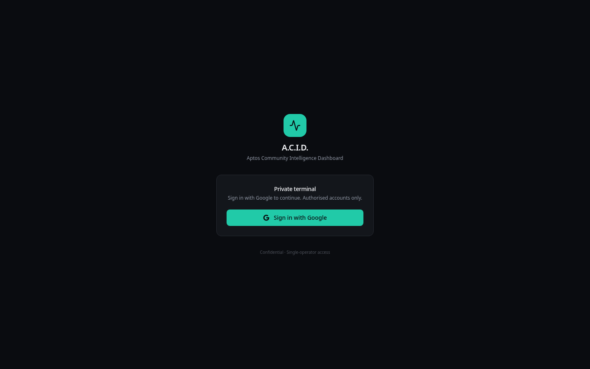
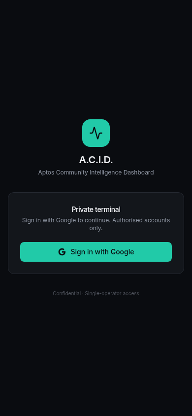
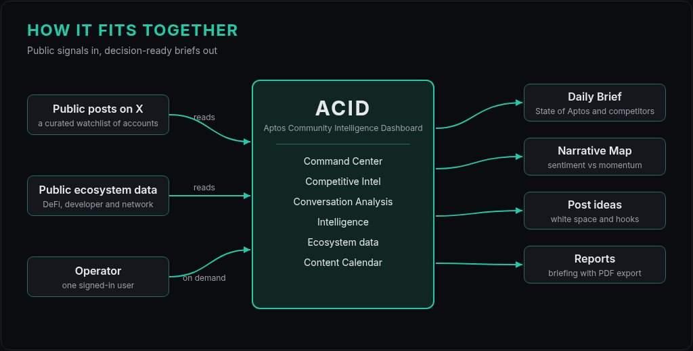

# ACID

**Aptos Community Intelligence Dashboard.** A private daily briefing for community teams in the [Aptos](https://aptosnetwork.com/) ecosystem: what the conversation on X is saying today, how people feel, which narratives are rising, where the risks are, and how Aptos compares with other ecosystems.

**Private tool** · sign-in restricted to one authorised account · source code is private

## What it is

A community team's day starts with the same questions: what are people saying about us, what changed overnight, which conversations need a reply, and what should we post next? The answers are spread across hundreds of posts and replies. ACID reads the public conversation around a curated watchlist of core Aptos accounts, ecosystem partners and competitors, and turns it into a short brief, a few clear scores and a list of next actions, alongside public DeFi, developer and network data.

## Who it's for

Community managers and ecosystem teams who need a decision-ready read of the conversation without scrolling a feed all day. ACID is built for a single operator: me.

## My role

Community manager and product builder. I designed ACID around my own day-to-day community work, built it, and run it as its only user.

## What it does

### Command Center
- The latest posts from the watchlist (core, ecosystem and competitor accounts), filterable by group
- **Daily Brief**: the state of Aptos and the state of competitors in a few lines, with changes since the last refresh
- **Aptos Pulse**: a community health gauge
- **Narrative Radar**: the three to five narratives leading the conversation, and which way each is moving
- Top risks, opportunities and an action queue with urgency labels
- Signal quality: how much of the conversation is substantive rather than spam or noise
- **Analyze any post**: the sentiment, themes, temperature and representative voices in its replies

### Project View
- Tabs for core accounts, ecosystem partners, competitors and two flagship ecosystem projects
- An overview, posts and narratives for each; flagship tabs focus on posts with 100+ likes

### Competitive Intel
- Aptos alongside other L1 and L2 ecosystems, ranked by sentiment, share of voice and engagement quality
- Narrative battles, plus Aptos strengths and weaknesses
- **Competitive Narrative Map**: sentiment against narrative momentum, bubbles sized by share of voice, four quadrants (Leading, Strong but Stalling, Rising Underdog, Trailing) and a "How to read" guide reminding you it's a prompt to look closer, not a verdict

### Conversation Analysis (Post Analyzer)
- Paste any X post link for a deep dive into its replies: sentiment, community temperature, praise, criticism and confusion, how well the replies match the post's message, representative voices and suggested responses
- Shows how many replies were substantive and how many were set aside as noise
- Recent analyses reopen instantly

### Intelligence
- Community alerts by severity, what changed, emerging narratives on a timeline, confusion hotspots, trust indicators, and recurring complaints and praise
- Health metrics: signal-to-noise, spam share, criticism and praise density, confusion index and share of voice

### Ecosystem data
- **Ecosystem Strength Index**: one 0–100 score with a breakdown of its components
- **Network Pulse**: live Aptos network statistics such as daily transactions, throughput, block height, epoch and active validators
- **Chain TVL**: the top Aptos DeFi protocols and a cross-chain comparison
- **Developer Activity**: Aptos repositories, contributors, commits and merged pull requests, compared with other ecosystems

### Content Calendar
- Daily post ideas drawn from what the watchlist and the team are posting
- What teammates have already covered, and the open white space nobody has posted about yet
- Each idea comes with a suggested posting window, a visual idea and three hooks compared side by side, and opens straight into a draft on X
- Remembers what was already posted so ideas don't repeat, and keeps comparisons neutral and factual

### Reports
- A decision-grade briefing: executive summary, risk level, key findings, today against the past week, narrative momentum, a four-part risk matrix (reputation, narrative, competitive, technical) and project comparisons
- PDF export

### Made for one operator
- Nothing refreshes in the background: updates happen when I ask, one group at a time, with cooldowns and a usage warning
- Standard and Comprehensive Scan modes, from a quick look to a deep dive
- Social views show whether their data is live, cached or failed, and the header shows how fresh each source is
- Methodology and Coverage notes explain what every number means
- Command palette, keyboard shortcuts, a post watchlist and a first-visit tour

## Screenshots

The dashboard sits behind sign-in, so only the sign-in screen is publicly visible.

| Desktop | Mobile |
| --- | --- |
|  |  |

## How it fits together

## Design decisions

- **Briefs before feeds.** The first screen is a short brief and a few scores, not a timeline to scroll.
- **Deliberate refreshes.** Nothing updates on its own, so every change on screen comes from a refresh I chose to run.
- **Plain labels and 0–100 scores.** Qualitative trend labels and normalised scores make projects comparable at a glance.
- **Honest maps.** Positions on the Narrative Map are relative to the current data, and the map says so.
- **Substance over noise.** Spam, emoji-only and other low-content replies are set aside before replies are scored, and the page shows how many.

## What I learned

- **Turning conversation into decisions**: a good brief names the risk, the opportunity and the next action.
- **Honest metrics**: say what a number is relative to, and show when data is cached or missing.
- **Designing for one operator**: building for my own daily routine kept every view focused on the next decision.

## Credits

Built by [@angelataptos](https://x.com/angelataptos)

## License

Copyright (c) 2026 Angel Fundora. All rights reserved. Source code is private.
See [LICENSE](LICENSE).
