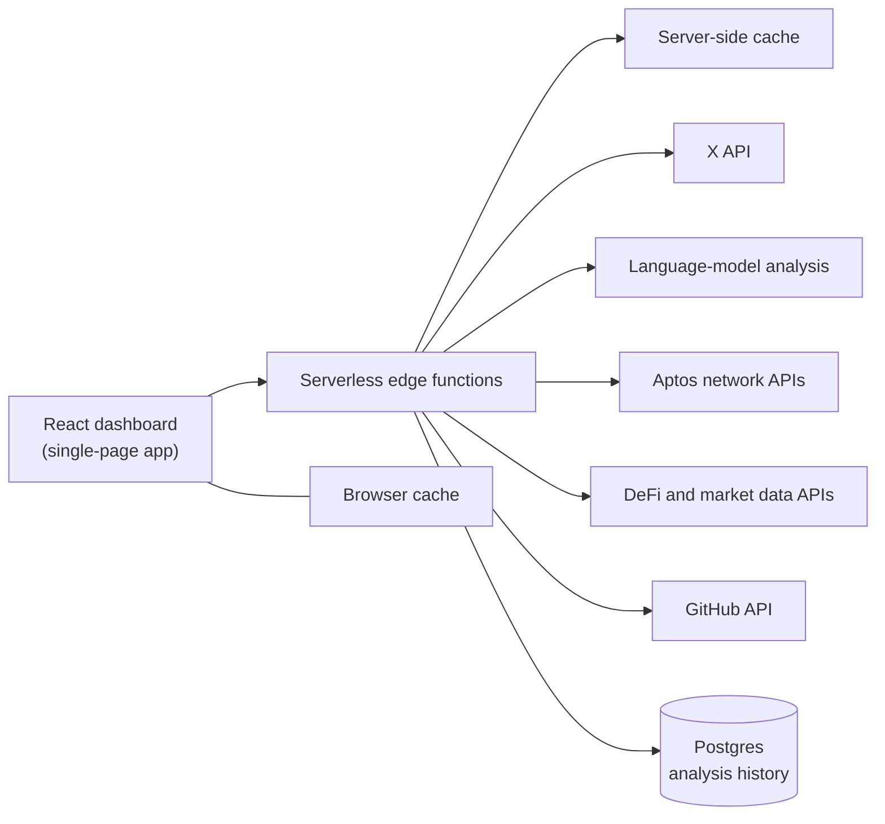

# ACID

**Aptos Community Intelligence Dashboard.** A real-time social and ecosystem intelligence console for the [Aptos](https://aptoslabs.com/) blockchain. ACID watches X activity across core Aptos accounts, ecosystem partners and competitors, then turns it into executive-ready sentiment, narrative and risk insights, alongside on-chain, market and developer data.

Built for community operations teams: every view favours clear insights, qualitative trend labels and operator-controlled spend over a raw content firehose.

> ACID is a private, invite-only dashboard. There is no public deployment.

## Features

### Command Center
- Feed of high-engagement posts from all tracked accounts, filterable by Core, Ecosystem and Competitors
- On-demand analysis of any post: fetches its replies and scores community sentiment
- Executive headline, risk and opportunity cards and recommended actions
- Positive and negative themes with momentum (rising, stable, declining)
- Aptos Pulse community health gauge and historical sentiment trend chart
- Live, cached and error indicators on every data view

### Project View
- Tabs for core accounts, ecosystem partners, competitors and flagship projects
- Per-project overview, posts and narrative tracking, with 7, 14, 30 and 90 day ranges

### Narrative Battlefield
- Side-by-side comparison of Aptos against other L1 and L2 ecosystems
- Rankings by sentiment, share of voice and engagement quality
- Competitive Narrative Map plotting sentiment against narrative momentum

### Intelligence
- Community alerts by severity, emerging narratives and confusion hotspots
- Health metrics such as signal-to-noise, spam share and criticism density

### Post Analyzer
- Paste any X post URL for a deep dive: reply sentiment, praise and criticism themes, narrative alignment and representative community voices

### Ecosystem Data
- **Chain TVL**: top Aptos protocols and cross-chain comparison
- **Developer Activity**: Aptos repositories, contributors and ecosystem comparison
- **Network Pulse**: live Aptos network statistics
- **Token Markets**: APT market data and top exchanges by volume
- **Ecosystem Strength Index**: a composite score with component breakdown
- **Content Calendar** for planning community content

### Reports
- Weekly executive reports with risk level, key findings, recommendations and project comparisons
- PDF export

### Operator Controls
- Manual-first: no background fetching, every external call is operator-initiated
- Per-category refresh with cost estimates, cooldowns and session budget warnings
- Standard and Comprehensive Scan modes to trade depth against cost
- Multi-layer caching to avoid paying twice for the same data
- Built-in Methodology and Coverage drawers explaining how every number is produced
- Keyboard shortcuts

## Architecture

- **Front end**: a React and TypeScript single-page app built with Vite, styled with Tailwind CSS
- **Backend**: serverless edge functions that proxy every external call, so API credentials never reach the browser
- **Data**: X for social signals, Aptos network APIs, public DeFi, market and GitHub data
- **Storage**: Postgres for historical analysis snapshots, plus server-side and browser caching

## Credits

Built by [@angelataptos](https://x.com/angelataptos)

## License

Copyright (c) 2026 Angel Fundora. All rights reserved. Source code is private.
See [LICENSE](LICENSE).
